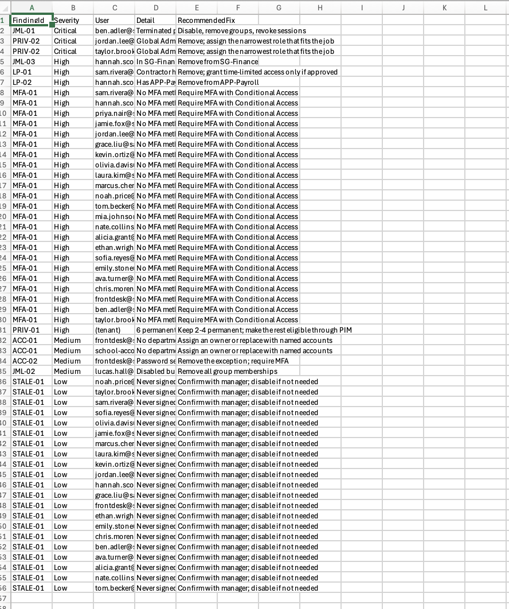
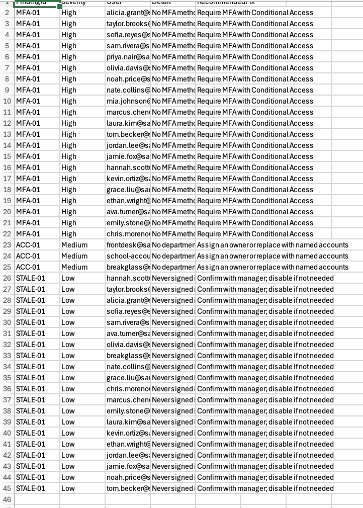
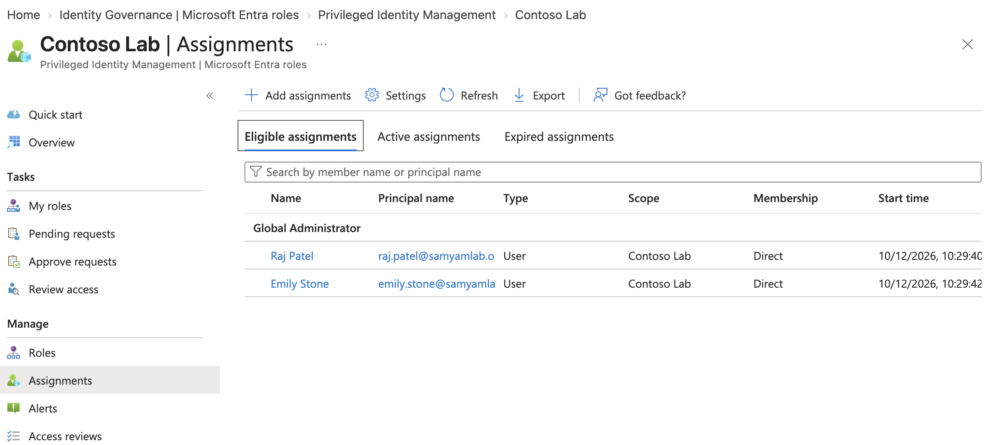
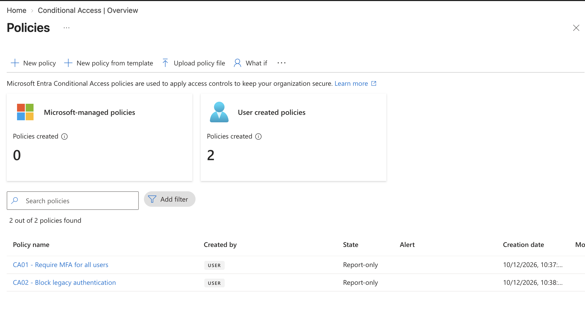
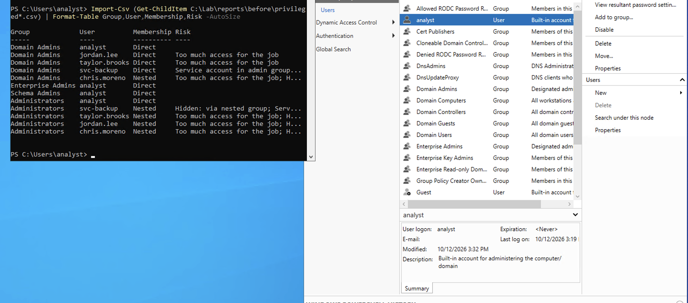

# IAM Access Review Lab

I wanted to learn what an IAM analyst actually does day to day, so I built a fake company in Microsoft Entra ID and Active Directory, broke its access on purpose, then wrote scripts to find the problems and fixed them.

I used Claude to help me write the scripts. I set everything up, ran it all, and fixed things when they broke (a lot broke).

## What I did

- Made a fake company called Contoso Lab with 25 employees in 6 departments
- Messed up their access on purpose in 8 ways that happen in real companies
- Wrote a PowerShell script that checks everyone's access and makes a report
- Fixed everything the report found
- Did the same thing in Active Directory on an Azure VM

## The 8 problems I planted

1. An IT intern had full admin rights
2. A help desk tech had full admin rights when he only needs to reset passwords
3. Too many people were full admins
4. Someone who quit still had a working account
5. Someone's account was turned off but they were still in groups
6. Someone moved from Finance to Sales and kept their Finance and payroll access
7. A contractor got added to payroll
8. A shared "Front Desk" account with no owner and a password that never expires

My script found all 8. It also found one I didn't plant: my school account was still a full admin in the tenant because I used it to set things up.

## Before and after

| | Before | After |
|---|---|---|
| Critical findings | 3 | 0 |
| Full admins | 6 | 2 |
| People with leftover access | 3 | 0 |
| MFA required | no one | everyone |
| AD admins that shouldn't be | 4 | 0 |
| AD password length | 7 | 14 |
| AD account lockout | never | after 10 tries |

## How I fixed it

- Took admin rights away from people who didn't need them
- Set up PIM so the IT admins only get admin rights when they ask for it, for 4 hours max
- Turned on MFA for everyone with Conditional Access
- Made an emergency admin account in case I locked myself out
- Set up a review every 3 months for who has payroll access
- Wrote a simple policy for what happens when people join, move or leave
- In AD, gave the help desk permission to reset passwords only, instead of full admin, and made the password policy stronger

## Stuff that went wrong

- My first script said it created all the users but it didn't create any. The module wasn't installed and the script just kept going. Now the scripts stop at the first error.
- Installing the full Microsoft Graph module filled up my laptop. I only installed the parts I needed.
- My own report had a false alarm. It said people were "still in groups" when they weren't. I had to fix the script and run it again.
- In AD, one help desk guy was secretly a Domain Admin because he was in a group that was inside the admin group. You only see it if you check groups inside groups.
- The default AD settings never locked accounts after wrong passwords, so someone could guess passwords forever. I didn't expect that one.
- Also lots of Azure errors, a git merge conflict, and my school blocking me from parts of the portal.

## What's in here

- `data` - the fake employee list and who quit
- `scripts/entra` - the Entra ID scripts
- `scripts/ad` - the Active Directory scripts
- `reports` - the before and after reports
- `docs` - findings summary and the join/move/leave policy
- `screenshots`

## Screenshots

Findings before

Findings after

PIM, admins only get access when they request it

Conditional Access policies

The hidden Domain Admin

